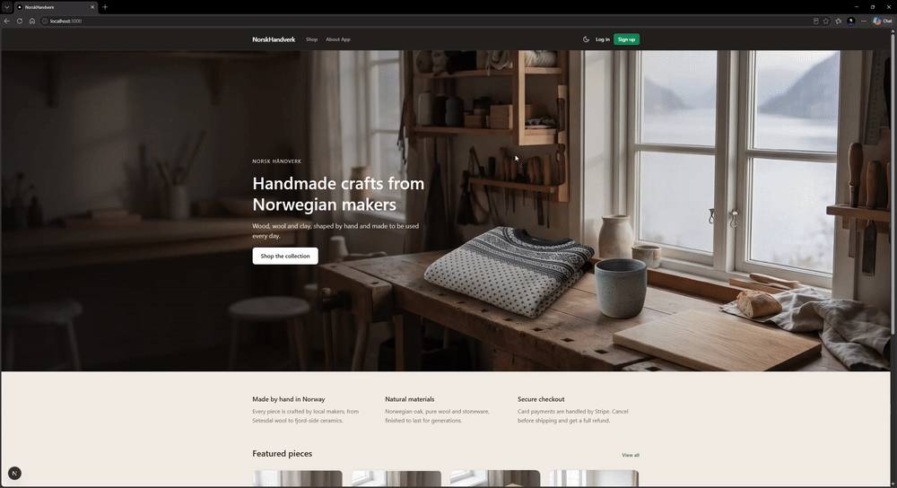
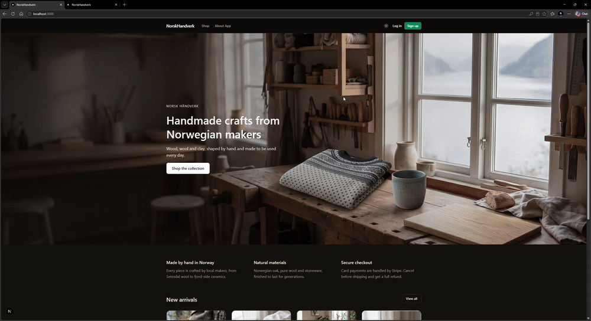
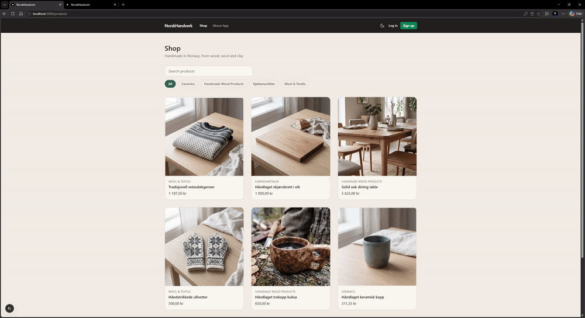

[](https://github.com/devrimsavas/NorskHandverk/actions/workflows/ci.yml)

# NorskHandverk

A full-stack web shop for handmade Norwegian crafts: wood, wool and clay. Customers browse products, fill a cart, pay with Stripe, follow their orders and cancel them with an automatic refund. Admins manage the catalog, customers and orders.

> Demo project: no real orders are shipped, and payments run in Stripe test mode. Pay with the test card `4242 4242 4242 4242`, any future expiry date and any CVC.

## Why This Project

Most demo shops stop at the cart. The goal of NorskHandverk is the part that usually gets skipped: a payment flow that stays correct when real things go wrong. A customer refreshes the checkout page, a webhook arrives late or never, a payment is canceled in Stripe, an order is canceled after it was paid. Every one of these cases is handled on the server, and the order, cart, stock and transaction records always end up consistent with what happened in Stripe.

> Work in progress.

### Screenshots

**Home page and shop**



**Admin Panel**


**Customer Panel**


## Roadmap

_Last updated: 2026-11-02_

- [x] PostgreSQL database with Entity Framework Core migrations
- [x] Data models: products, brands, categories, customers, carts, orders, transactions
- [x] Product, brand and category CRUD with soft delete
- [x] Cart with stock reservation (stock is reserved when an item is added and returned when it is removed)
- [x] Stripe checkout with server-side price and VAT calculation
- [x] Idempotent checkout: retries reuse the existing payment intent instead of creating duplicate orders
- [x] Stripe webhooks with signature verification
- [x] Recovery when a webhook never arrives: resuming checkout detects an already paid intent and completes the order
- [x] Order cancellation: unpaid orders cancel their payment intent, paid orders are refunded through Stripe
- [x] Transaction records that follow the payment (pending, success, canceled, refunded)
- [x] Orders linked to the cart they were created from
- [x] Status lookups as enums bound to seeded IDs, no magic numbers
- [x] JWT authentication with customer and admin roles
- [x] Customer id taken from the token on every customer endpoint, never from the URL or request body
- [x] Ownership checks: customers only reach their own orders, other orders return `404`
- [x] First admin user created on startup from configuration
- [x] Admin accounts protected from deletion, so the shop can never lose its last admin
- [x] Discounts applied consistently: shop, cart and checkout use the same price
- [x] Next.js storefront: home page, shop with search and category filter, product details, registration and login
- [x] Customer account: profile, cart and order history with cancellation
- [x] Payment page that handles a failed payment form, and a result page based on Stripe's redirect status
- [x] Light and dark theme based on design tokens
- [x] Admin panel for products, orders, customers, brands, categories and carts
- [x] Product image upload with type and size validation, behind a storage interface
- [x] Order status workflow for admins (ordered, in progress, delivered)
- [x] Norwegian VAT rates per category, validated on the server
- [x] Background job that releases stock from abandoned carts
- [x] Mobile menu
- [x] Unit tests for pricing and order status rules
- [x] Integration tests against PostgreSQL, with Stripe replaced by a fake payment service
- [x] Continuous integration with GitHub Actions (tests against PostgreSQL and a production frontend build on every push)
- [ ] Deployment

## Tech Stack

- ASP.NET Core 9 Web API, C#
- Entity Framework Core with PostgreSQL (Npgsql)
- AutoMapper
- Stripe.net (Payment Intents, webhooks, refunds)
- JWT bearer authentication, ASP.NET Core `PasswordHasher`
- Swashbuckle (Swagger UI)
- Next.js 16 (App Router), React 19, TypeScript, Tailwind CSS 4
- Stripe.js and React Stripe.js (Payment Element)
- xUnit, `WebApplicationFactory` (integration tests)
- GitHub Actions (CI with a PostgreSQL service container)

## Project Structure

```
NorskHandverk/
├── .github/workflows/ci.yml     # GitHub Actions: backend tests and frontend build
├── NorskHandverk/               # ASP.NET Core Web API
│   ├── Controllers/             # Auth, Product, Brand, Category, Customer, Cart, Order
│   ├── Data/                    # AdminSeeder (first admin user on startup)
│   ├── DTOs/                    # Request and response models per area
│   ├── Extensions/              # ClaimsPrincipal.GetCustomerId()
│   ├── Mappings/                # AutoMapper profiles
│   ├── Migrations/              # EF Core migrations
│   ├── Models/                  # Entities, status enums, JwtSettings
│   ├── Services/                # Auth, orders, Stripe, image storage, abandoned cart job
│   └── wwwroot/images/products/ # Product images, served as static files
├── NorskHandverk.Tests/         # xUnit tests
│   ├── Fakes/                   # FakePaymentService (replaces Stripe)
│   └── Integration/             # API factory, helpers and integration tests
└── FrontEnd/
    └── norskhandelfe/           # Next.js app
        ├── app/                 # Pages: shop, products, account, admin, login, register, payment
        ├── components/          # Header, footer, product card, product image, theme toggle, admin forms
        ├── context/             # AuthContext
        └── lib/                 # apiFetch, auth storage, types, formatting, API paths, order statuses
```

## Getting Started

### Prerequisites

- .NET 9 SDK
- Node.js 20 or later
- PostgreSQL
- A Stripe account in test mode and the [Stripe CLI](https://stripe.com/docs/stripe-cli) for local webhooks

### Backend

Create `NorskHandverk/appsettings.json` (it is not committed to the repository):

```json
{
  "Logging": {
    "LogLevel": {
      "Default": "Information",
      "Microsoft.AspNetCore": "Warning"
    }
  },
  "AllowedHosts": "*",
  "ConnectionStrings": {
    "DefaultConnection": "Host=localhost;Port=5432;Database=norskhandverk;Username=postgres;Password=<your-password>"
  },
  "Stripe": {
    "SecretKey": "sk_test_...",
    "PublishableKey": "pk_test_...",
    "WebhookSecret": "whsec_..."
  },
  "Jwt": {
    "SecretKey": "<a long random string>",
    "Issuer": "NorskHandverk",
    "Audience": "NorskHandverkClient",
    "ExpiryMinutes": 60
  },
  "AdminUser": {
    "Email": "admin@norskhandverk.test",
    "Password": "<admin-password>",
    "Name": "Admin",
    "Surname": "NorskHandverk"
  }
}
```

A strong JWT key can be generated in PowerShell:

```powershell
$b = New-Object byte[] 64; [System.Security.Cryptography.RandomNumberGenerator]::Create().GetBytes($b); [Convert]::ToBase64String($b)
```

Apply the migrations and start the API:

```bash
cd NorskHandverk
dotnet ef database update
dotnet run --launch-profile https
```

The API runs on `https://localhost:7140`. On the first start, an admin user is created from the `AdminUser` section if no admin exists yet. Log in with it on the website to reach the admin panel at `/admin`.

Product images are stored in `NorskHandverk/wwwroot/images/products/` and served from `https://localhost:7140/images/products/`.

### Stripe webhooks

Forward Stripe events to the local API:

```bash
stripe login
stripe listen --forward-to https://localhost:7140/api/order/webhook
```

`stripe listen` prints a `whsec_...` signing secret. Put it in `Stripe:WebhookSecret` and restart the API.

### Frontend

Create `FrontEnd/norskhandelfe/.env.local`:

```
NEXT_PUBLIC_BASE_API_URL=https://localhost:7140/api
NEXT_PUBLIC_STRIPE_PUBLISHABLE_KEY=pk_test_...
```

```bash
cd FrontEnd/norskhandelfe
npm ci
npm run dev
```

Open `http://localhost:3000`.

## Frontend

The frontend is a Next.js app with the App Router, styled with Tailwind CSS 4 and supporting light and dark mode.

### Features

- **Visitors:** home page with the newest products, shop with search and category filter, product details, registration with automatic login
- **Customers:** add to cart, change quantities, Stripe checkout, profile editing, order history, resume an unfinished payment, cancel an order with refund
- **Admins:** manage products with image upload and a live price preview, move orders through their status workflow, cancel and refund orders, view customers and carts, manage brands and categories

### Architecture

- **`apiFetch`** wraps `fetch`, adds the API base URL and the JWT token to every request, and leaves the `Content-Type` to the browser for file uploads
- **`AuthContext`** keeps the logged-in user in React state and in `localStorage`, and exposes `login` and `logout`. Expired tokens are removed when they are read
- **Route layouts:** `app/account/layout.tsx` sends visitors to the login page, `app/admin/layout.tsx` also sends customers back to the shop. Real authorization is enforced by the API
- **`ProductImage`** shows a product image or an "Image coming soon" placeholder, used by the shop, cart and admin pages
- **Client-side search and filter:** the catalog is small, so the shop filters products in the browser. A large catalog would move this to query parameters on the API
- **Server and client components:** static pages such as the home page are server components, only the parts that fetch data in the browser are client components
- **Design tokens:** colors are named by purpose (`page`, `surface`, `ink`, `muted`, `accent`) and defined once for each theme in `globals.css`, so the whole interface switches theme without `dark:` classes on every element
- **No theme flash:** a small inline script applies the saved theme before the first paint

## Payment Flow

```
Cart (active) ──checkout──▶ Order (awaiting payment) ──webhook: payment succeeded──▶ Order (ordered)
                             Cart (checked out)                                     Cart (completed)
                             Transaction (pending)                                  Transaction (success)
```

1. **Checkout** calculates the total on the server from the cart, including VAT, and creates a Stripe Payment Intent. The client never sends a price.
2. **Order lines are snapshots:** product name, unit price and VAT rate are copied into each order line, so later price changes do not rewrite past orders.
3. **The webhook** is verified with the Stripe signature before anything is updated. On `payment_intent.succeeded` the order becomes _ordered_, its transaction _success_ and its cart _completed_. A repeated webhook finds no pending transaction and changes nothing.
4. **Resuming checkout** looks up the open order first and asks Stripe for the state of its payment intent:

| Payment intent state | Result                                                                                            |
| -------------------- | ------------------------------------------------------------------------------------------------- |
| Still payable        | The same intent is returned, no new order is created                                              |
| `succeeded`          | The webhook never arrived: the order is completed now and the API returns `409 Conflict`          |
| `canceled`           | The stale order and its transaction are canceled, the cart is reopened and a new order is created |

5. **Cancellation** calls Stripe first, so a failed Stripe call leaves the database untouched:

| Order status                     | Stripe                     | Transaction | Stock    |
| -------------------------------- | -------------------------- | ----------- | -------- |
| Awaiting payment                 | Payment intent canceled    | Canceled    | Returned |
| Ordered                          | Payment refunded           | Refunded    | Returned |
| In progress, delivered, canceled | Not allowed, returns `400` | -           | -        |

6. **The result page only informs the customer.** After payment, Stripe redirects to `/order-success` with a `redirect_status` (`succeeded`, `processing` or `failed`), and the page shows the matching message. Whether an order counts as paid is decided by the verified webhook alone, so editing the URL cannot mark an order as paid.

## Order Status Workflow

After payment, admins move orders forward one step at a time. The allowed transitions live in a single dictionary in `OrderController`, so the rules are in one place:

```
Ordered ──▶ In Progress ──▶ Delivered
```

| Request                                    | Result                                                                                      |
| ------------------------------------------ | ------------------------------------------------------------------------------------------- |
| Ordered → In Progress                      | Allowed                                                                                     |
| In Progress → Delivered                    | Allowed                                                                                     |
| Skipping a step (Ordered → Delivered)      | `400 Bad Request`                                                                           |
| Going back (Delivered → Ordered)           | `400 Bad Request`                                                                           |
| Changing an order that is awaiting payment | `400 Bad Request`, it has not been paid yet                                                 |
| Setting Canceled                           | `400 Bad Request`, cancellation goes through the cancel endpoint so the payment is refunded |

Once an order is in progress, customers can no longer cancel it.

## Pricing and VAT

- **Discounts are taken off the net price, and VAT is calculated on the discounted price:** `(price − discount) × (1 + VAT rate)`. The same formula is used for the shop price, the cart line, the checkout total and the price preview in the admin product form, so the customer always pays the price shown in the shop.
- **VAT comes from the product's category.** The admin picks one of the Norwegian rates (25% general, 15% food, 12% transport and culture, 0% exempt), and the API rejects any rate outside 0–1, so a mistyped `25` cannot become 2500% VAT.
- **Cart and order lines copy the price and VAT rate** when they are created, so changing a category's VAT later only affects new carts.

## Product Images

- `POST /api/Product/{id}/image` accepts a JPG, PNG or WebP file up to 5 MB as `multipart/form-data`.
- **Uploaded file names are never used.** Each image is saved under a random name, which prevents overwriting another product's image and path traversal attempts such as `../appsettings.json`.
- **The new image is saved before the old one is deleted**, so a failed upload never leaves a product without its image.
- **Storage sits behind `IImageStorage`.** `LocalImageStorage` writes to `wwwroot`. Moving to cloud storage such as Backblaze B2 or S3 only needs a new implementation, the controller stays the same.
- Products without an image show an "Image coming soon" placeholder instead of a broken image.

## Authentication and Authorization

- `POST /api/Auth/login` checks the password with ASP.NET Core's `PasswordHasher` and returns a signed JWT with the customer id, name and role. A wrong email and a wrong password return the same `401`, so the endpoint does not reveal which emails are registered.
- **Customer endpoints read the customer id from the token** (`User.GetCustomerId()`), never from the URL or request body, so a customer cannot act on someone else's cart or orders by changing an id.
- **Ownership checks return `404`, not `403`:** a customer asking for another customer's order gets "not found", which does not reveal that the order exists. Admins can see every order.
- **Registration cannot create an admin:** the registration and profile DTOs have no role field.
- **The first admin** is created on startup by `AdminSeeder` from configuration. It never turns an existing customer into an admin.
- **Admin accounts cannot be deleted.** A deleted admin could no longer log in, and the seeder would not create a new one, which would leave the shop without an admin.
- **Secrets** (database, Stripe, JWT key, admin password) live in `appsettings.json`, which is not committed. `AppSetting_Example.txt` shows the expected structure.

## API Documentation

In development, Swagger UI is available at `https://localhost:7140/swagger`.

### Trying authenticated endpoints in Swagger

1. Call `POST /api/Auth/login` with an email and password
2. Copy the `token` from the response
3. Click **Authorize** and paste the token
4. Customer and admin endpoints can now be called directly from the page

## API Endpoints

Authenticated endpoints require an `Authorization: Bearer <token>` header.

| Method | Endpoint                  | Access        | Description                                                                      |
| ------ | ------------------------- | ------------- | -------------------------------------------------------------------------------- |
| POST   | `/api/Auth/login`         | Public        | Log in with email and password, returns a JWT                                    |
| POST   | `/api/Customer`           | Public        | Register a customer account                                                      |
| GET    | `/api/Customer/me`        | Authenticated | Profile of the logged-in customer                                                |
| PUT    | `/api/Customer/me`        | Authenticated | Update own profile (only the fields that are sent)                               |
| GET    | `/api/Customer`           | Admin         | List all customers                                                               |
| GET    | `/api/Customer/{id}`      | Admin         | Customer details                                                                 |
| PUT    | `/api/Customer/{id}`      | Admin         | Update a customer                                                                |
| DELETE | `/api/Customer/{id}`      | Admin         | Soft delete a customer without orders (admin accounts cannot be deleted)         |
| GET    | `/api/Product`            | Public        | List products (soft-deleted products are hidden)                                 |
| GET    | `/api/Product/{id}`       | Public        | Product details                                                                  |
| POST   | `/api/Product`            | Admin         | Create a product                                                                 |
| PUT    | `/api/Product/{id}`       | Admin         | Update a product                                                                 |
| DELETE | `/api/Product/{id}`       | Admin         | Soft delete a product                                                            |
| POST   | `/api/Product/{id}/image` | Admin         | Upload or replace the product image (JPG, PNG or WebP, up to 5 MB)               |
| GET    | `/api/Brand`              | Public        | List brands                                                                      |
| GET    | `/api/Brand/{id}`         | Public        | Brand details                                                                    |
| POST   | `/api/Brand`              | Admin         | Create a brand                                                                   |
| PUT    | `/api/Brand/{id}`         | Admin         | Rename a brand (names must be unique)                                            |
| DELETE | `/api/Brand/{id}`         | Admin         | Delete a brand without products                                                  |
| GET    | `/api/Category`           | Public        | List categories                                                                  |
| POST   | `/api/Category`           | Admin         | Create a category                                                                |
| PUT    | `/api/Category/{id}`      | Admin         | Update a category (unique name, VAT rate between 0 and 1)                        |
| DELETE | `/api/Category/{id}`      | Admin         | Soft delete a category without products                                          |
| GET    | `/api/Cart/me`            | Authenticated | Active cart of the logged-in customer                                            |
| POST   | `/api/Cart`               | Authenticated | Add a product to the cart (reserves stock)                                       |
| POST   | `/api/Cart/updatecart`    | Authenticated | Set the quantity of a cart item (`0` removes it)                                 |
| POST   | `/api/Cart/removeitem`    | Authenticated | Remove a quantity of a product from the cart                                     |
| POST   | `/api/Cart/clearcart`     | Authenticated | Empty the cart and return the stock                                              |
| GET    | `/api/Cart`               | Admin         | List all carts                                                                   |
| GET    | `/api/Cart/active`        | Admin         | List active carts                                                                |
| GET    | `/api/Cart/active/{id}`   | Admin         | Cart details                                                                     |
| GET    | `/api/Cart/customer/{id}` | Admin         | Carts of a customer                                                              |
| POST   | `/api/Order/checkout`     | Authenticated | Create or resume the order for the active cart, returns the Stripe client secret |
| GET    | `/api/Order/me`           | Authenticated | Orders of the logged-in customer, newest first                                   |
| GET    | `/api/Order/{id}`         | Owner, Admin  | Order details                                                                    |
| POST   | `/api/Order/cancel/{id}`  | Owner, Admin  | Cancel an order (cancels or refunds the Stripe payment)                          |
| GET    | `/api/Order`              | Admin         | List all orders with customer name and email                                     |
| PATCH  | `/api/Order/{id}/status`  | Admin         | Move an order one step forward (`InProgress`, `Delivered`)                       |
| POST   | `/api/Order/webhook`      | Stripe        | Stripe webhook, verified with the signing secret                                 |

## Status Values

Statuses are lookup tables in the database, and the same values exist as C# enums. The enum values are bound to the seeded IDs in `AppDbContext`, so the code never compares against bare numbers or names.

| Entity      | Statuses                                                    |
| ----------- | ----------------------------------------------------------- |
| Order       | Canceled, Ordered, In Progress, Delivered, Awaiting Payment |
| Cart        | Active, Checked Out, Abandoned, Completed                   |
| Transaction | Pending, Success, Failed, Canceled, Refunded                |

## Abandoned Carts

Adding an item to a cart reserves its stock. If a customer leaves without paying, that stock would stay locked forever, and the shop could show a product as sold out without a single sale.

A background job (`AbandonedCartJob`, an ASP.NET Core `BackgroundService`) solves this:

- It runs once at startup and then on a fixed interval.
- Active carts that have not changed for longer than the timeout are marked as **abandoned**, and their items go back into stock. The items stay in the cart for history.
- Every cart change updates `UpdatedAt`, so a customer who is still shopping never loses their cart.
- The logic lives in `AbandonedCartService`, separate from the timer, so it can be tested without waiting.
- Each run opens its own DI scope, so it gets a fresh, short-lived `DbContext` instead of holding one open for the lifetime of the app.

Both values are configured in `appsettings.json`:

```json
"AbandonedCarts": {
  "TimeoutMinutes": 1440,
  "CheckIntervalMinutes": 60
}
```

## Testing

The project has 24 automated tests: fast unit tests for the business rules, and integration tests that call the real API over HTTP.

```bash
dotnet test
```

### Test suites

| Test class              | Type        | Database   | What it covers                                                                                                                                                    |
| ----------------------- | ----------- | ---------- | ----------------------------------------------------------------------------------------------------------------------------------------------------------------- |
| `PricingTests`          | Unit        | No         | Price including VAT, discount taken off the net price, all four Norwegian VAT rates                                                                               |
| `OrderStatusRulesTests` | Unit        | No         | Allowed transitions (one step forward) and rejected ones (skipping, going back, unpaid orders, cancellation)                                                      |
| `AuthApiTests`          | Integration | PostgreSQL | Admin login, wrong password (`401`), missing token (`401`), customer calling an admin endpoint (`403`)                                                            |
| `OrderApiTests`         | Integration | PostgreSQL | Total calculated on the server, another customer's order (`404`), canceling an unpaid order, recovering a paid order whose webhook never arrived and refunding it |
| `AbandonedCartTests`    | Integration | PostgreSQL | Old carts are abandoned and their stock returned, recent carts are left alone                                                                                     |

### How the integration tests work

- **The real API runs in memory** through `WebApplicationFactory<Program>`. Requests go through routing, JWT authentication, controllers, EF Core and PostgreSQL, exactly like in production.
- **A separate test database** (`norskhandverk_test`) is deleted and rebuilt from the migrations before every run, so tests never touch real data. As a safety check, the factory refuses to run if the connection string does not point to a test database.
- **Stripe is replaced by `FakePaymentService`**, which implements the same `IPaymentService` interface. It makes no network calls and records every cancel and refund, so tests can assert on them. It can also mark a payment as succeeded, which is how the "webhook never arrived" case is tested.
- **The background job is removed** so it cannot change carts while tests run. Its logic is tested by calling `AbandonedCartService` directly.
- **Tests create their own data** (category, brand, product, customers) through the API, with unique names, so they do not depend on each other or on existing data.
- **JWT, admin and database settings are given by the factory**, so the tests do not need a local `appsettings.json` and run the same way in CI.

### Running the integration tests locally

The integration tests need PostgreSQL and a connection string in the `TEST_DB_CONNECTION` environment variable. The database is created by the tests:

```powershell
setx TEST_DB_CONNECTION "Host=localhost;Port=5432;Database=norskhandverk_test;Username=postgres;Password=<your-password>"
```

Restart Visual Studio or the terminal after `setx`, so the new variable is picked up.

## Continuous Integration

Every push and pull request to `master` runs a GitHub Actions workflow with two parallel jobs:

| Job        | Steps                                                                                                             |
| ---------- | ----------------------------------------------------------------------------------------------------------------- |
| `backend`  | Starts a PostgreSQL 17 service container, restores and builds the solution, and runs all tests against it         |
| `frontend` | Installs Node.js dependencies with `npm ci` and builds the Next.js app for production, catching TypeScript errors |

No secrets are needed: the tests use a fake payment service and their own JWT and admin settings.

## License

See [LICENSE.txt](LICENSE.txt).
